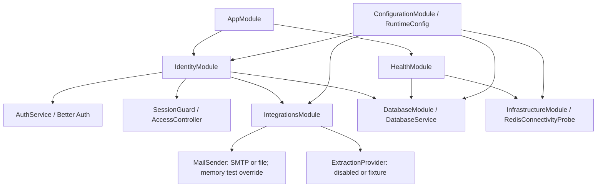

# Architecture and consistency checkpoints

Read this before the next feature batch. **Current classes are implemented; future feature classes, fields, and events below are proposals, not new product-policy approvals.** One NestJS application, one PostgreSQL database, plain pnpm workspaces. No microservices, generic event framework, or extra infrastructure.

## Progress toward the product
Identity/session/roles, local infrastructure, test tooling, API documentation, and replaceable integration boundaries exist. The accepted form-editor spike is disposable, not application UI. **None of the six recruitment scenarios in [`product.md`](product.md) is complete end-to-end yet**; candidate verification is an implemented part of scenario 2. A percentage would confuse foundation work with delivered workflow coverage.

| Capability | Current evidence | Still missing |
| --- | --- | --- |
| Email-code access | Real OTP, cookie sessions, roles; SMTP and captured-mail checks | Production delivery and staff-management UI/API |
| Vacancy authoring | Accepted isolated editor; proposed API shapes | Database records, draft/publish/close, real editor |
| Applications | Shared vocabulary and account identity | Submission, uniqueness, answers, application-specific documents |
| Assisted review | Extraction result union; disabled/labelled fixture adapter | Document parsing, live extractors, durable processing, review, CSV |
| Interviews/decisions | Agreed stage/authority direction | Scheduling, assignments, notes, owner decisions |
| Candidate updates/metrics | Proposed boundaries | Explicit publication/sending, database-derived reports |

## Current component map

| Component / classes | Responsibility and boundary |
| --- | --- |
| `ConfigurationModule`, `readRuntimeConfig` | Read project environment once at startup; validate selected drivers; reject production captures/fixtures. No secret dumps. |
| `DatabaseService` | One application pool, parameterized queries, transaction helper, readiness, shutdown. Better Auth uses its pool directly; other business modules must not depend on AuthService for SQL. |
| `IdentityModule`, `AuthService`, `SessionGuard` | Better Auth owns OTP/session lifecycle and tables. Guard produces a small trusted actor and role checks. Resource permissions remain a feature-service responsibility. |
| `IntegrationsModule`, `MailSender` | Select transport at construction. SMTP protocol/credentials stay in `SmtpMailSender`; file capture and memory tests need no external mail account. |
| `ExtractionProvider` | Provider seam only. Disabled fails explicitly; fixture returns recorded data with provenance. No live AI, parser, task runner, or candidate processing is implied. |
| `HealthModule`, `ConnectivityProbe` | Check database and Redis through adapters. Redis is connectivity-only, not an implemented cache/queue. Failure responses contain statuses, not underlying errors. |
| `configureApplication` | Shared production/test HTTP wiring: trusted socket IP, raw-body cap, cookie forwarding, CORS. Test provider overrides do not introduce HTTP authentication bypasses. |

## Current data movement
1. A code request reaches Better Auth through the bounded auth handler.
2. Better Auth manages the code/expiry/attempt state in PostgreSQL and calls the injected `MailSender`.
3. SMTP sends to Mailpit by default; file mode captures privately; tests can intercept messages in memory.
4. Code verification creates/reuses a candidate and a real cookie session. No fixed code or automatic staff role.
5. Nest requests pass through `SessionGuard`; role and identity come from library-validated sessions, never the submitted JSON.
6. Operator provisioning changes role and revokes sessions in one transaction. The database pool closes once at application shutdown.

Code-send acceptance still does not prove delivery: Better Auth may log sender failures while returning 200. Replacing transport does not silently change that library contract. See [`api.md`](api.md).

## Proposed feature classes and call direction
Feature modules should start small: controller → service → repository. Services enforce transitions/ownership; repositories own SQL; adapters own protocols. Do not create a class per field or add interfaces around every ordinary function.

| Next module | Approximate classes / collaborators |
| --- | --- |
| Vacancies | `VacanciesController`, `PublicVacanciesController`, `VacancyService`, `VacancyRepository`; pure definition validation and public projection functions |
| Applications | `ApplicationsController`, `ApplicationService`, `ApplicationRepository`; later `DocumentService` plus a document-storage port with local/memory adapters |
| Processing/review | `ProcessingService`, `ProcessingRepository`, document-text reader port, `ExtractionProvider`; review/export functions; worker mechanism chosen at that checkpoint |
| Interviews | `InterviewsController`, `InterviewService`, `InterviewRepository`; assignment-scoped access in service |
| Communications | `CommunicationService`, repository, existing `MailSender`; separate candidate-publication records and deliberate send commands |
| Analytics | Small query service over persisted facts; no separate analytics database/service |

No provider SDK imports in vacancy/application services. Storage, parsing, scheduling, and live model adapters will be added only when their feature contracts exist; they are not stubbed-out products today.

## Proposed consistency fields and rules
These describe what the upcoming schemas must preserve, not tables that already exist.

| Record / field | Consistency purpose |
| --- | --- |
| Vacancy `id`, `ownerId`, `status`, `revision` | Stable resource identity and responsible recruiter. Server supplies ownership; expected revision prevents silently overwriting another recruiter's draft. Management/override rules need confirmation. |
| Definition `version`, input `id` / `name`, task `id` / `outputKey` | Version is wire-schema version, not vacancy edit count. Stable IDs identify source/task; unique names/output keys identify answers/export columns. Labels may change in drafts without becoming identity keys. |
| Application `id`, `candidateId`, `vacancyId`, `definitionSnapshot`, `submittedAt` | Database uniqueness on `(candidateId, vacancyId)`. Preserve the exact published intake snapshot; closing/reposting never rewrites historical submissions. |
| Document `id`, `applicationId`, `inputId`, `storageKey`, `contentHash`, `byteCount`, media type | Ownership follows application. Do not persist arbitrary public file URLs. Verify upload type/size server-side; business NO_LIMIT never disables operational caps. |
| Processing `jobId`, document hash/version, task ID, configuration version, `status`, attempts | Stable work/idempotency key excludes duplicate final results; recoverable state must live in PostgreSQL, not process memory. Lease fields depend on the eventual worker strategy. |
| Result source/task identity, `provenance`, status/value/evidence | Keep answer, extracted suggestion, and reviewed value distinct. Failure/null is not successful false/empty. Persist fixture/live provenance; never export fixture values as genuine model facts without labelling. |
| Review `reviewedBy`, `reviewedAt`, reviewed value | Attribute corrections; extraction retries must not overwrite HR review. |
| Interview `id`, `applicationId`, assigned user IDs, timestamps, `revision` | Multiple editable records, not numbered stages; assignment scopes visibility. Store UTC timestamps, render timezone separately. |
| Decision actor/time, internal stage, public update ID | Final decision authorization is separate from collaboration. Candidate-visible publication is explicit; negative outcome names remain unresolved. |
| Message `id`, actor, selected recipients, delivery state | Distinguish deliberate send request, acceptance, and delivery. Editing an interview is not a send command. |

### Transaction boundaries to establish with features
- Publish: validate and transition draft under concurrency protection; lock the published intake definition.
- Submit: coordinate the accepting vacancy state with close, validate against its snapshot, insert application/doc references and durable processing plan together; enforce duplicate application with a database constraint.
- Document storage is not a PostgreSQL transaction: stage uploads, finalize ownership after validation, and clean orphaned objects with an explicit recovery path.
- Complete processing: write result/provenance and task status consistently, then recompute review readiness. Failure/manual-bypass readiness policy is still open.
- Finalize: check actor/resource authority and transition in the same transaction. Do not assume a role guard alone handles ownership or stale revisions.
- Send: persist selected recipients/send intent before a later external call. Retry/state reconciliation is needed; SMTP cannot promise exactly-once delivery.

## Events: what exists versus what may be needed
**Currently: no domain event bus, worker, job queue, or outbox.** Requests call services directly and await results. Redis availability is not evidence of a worker.

Proposed meaningful boundaries:
- `ApplicationSubmitted`: durable per-document work plan; not an automatic selection decision.
- `ExtractionCompleted` / `ExtractionFailed`: update review availability, never auto-rank/reject.
- `InterviewChanged`: persist schedule/assignments; no automatic message.
- `DecisionRecorded` / `CandidateUpdatePublished`: distinct internal decision and explicit public update.
- `MessageSendRequested`: explicit actor/recipients; delivery tracking separate from business state.

Do not add an event bus just for these names. Polling can consume durable database work records directly. If an external queue is selected later, use an outbox or equivalent reconciliation to avoid the commit/enqueue gap. Persisted events would need `eventId`, schema version, aggregate ID/revision, time, and actor; consumers must be idempotent. See [`open-questions.md`](open-questions.md) for the unresolved worker decision.

## Next gate
Read [`vacancy-api-draft.md`](vacancy-api-draft.md) alongside the vacancy scenario in [`backend-modules.md`](backend-modules.md). Confirm the bounded field/task catalog and management permissions, then implement draft → publish → safe public retrieval. No more infrastructure detour is required before that slice.
