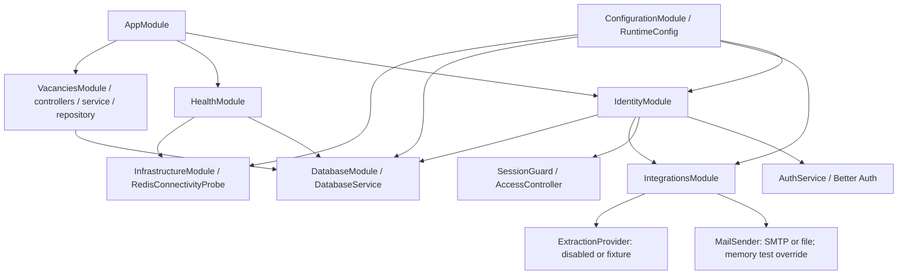

# Architecture and consistency checkpoints

Read this before the next feature batch. **Current classes are implemented; future feature classes, fields, and events below are proposals, not new product-policy approvals.** One NestJS application, one PostgreSQL database, plain pnpm workspaces. No microservices, generic event framework, or extra infrastructure.

## Progress toward the product
Identity, vacancies and locked intake/private documents are implemented through the API. Editor spike is disposable, not application UI. No scenario has a complete integrated frontend journey. Backend coverage is not delivered UI coverage.

| Capability | Current evidence | Still missing |
| --- | --- | --- |
| Email-code access | Real OTP, cookie sessions, roles; SMTP and captured-mail checks | Production delivery and staff-management UI/API |
| Vacancy authoring | Persisted draft/publish/close, strict definitions, owner checks and public projections; accepted isolated editor | Integrated graphical editor, extra presets |
| Applications | Locked intake/private documents, mock processing/recovery, optional review/export | Live AI/parser, progression and integrated UI |
| Assisted review | Extraction result union; disabled/labelled fixture adapter | Document parsing, live extractors, durable processing, review, CSV |
| Interviews/decisions | Agreed stage/authority direction | Scheduling, assignments, notes, owner decisions |
| Candidate updates/metrics | Proposed boundaries | Explicit publication/sending, database-derived reports |

## Current component map

| Component / classes | Responsibility and boundary |
| --- | --- |
| `ConfigurationModule`, `readRuntimeConfig` | Read project environment once at startup; validate selected drivers; reject production captures/fixtures. No secret dumps. |
| `DatabaseService` | One application pool, parameterized queries, transaction helper, readiness, shutdown. Better Auth uses its pool directly; other business modules must not depend on AuthService for SQL. |
| `IdentityModule`, `AuthService`, `SessionGuard` | Better Auth owns OTP/session lifecycle and tables. Guard produces a small trusted actor and role checks. Resource permissions remain a feature-service responsibility. |
| `IntegrationsModule`, `MailSender` | Select transport at construction. SMTP protocol/credentials stay in `SmtpMailSender`; file capture and memory tests need no external mail account. |
| `ExtractionProvider` | Provider seam only. Disabled fails explicitly; fixture returns recorded data with provenance. No live AI, parser, task runner, or candidate processing is implied. |
| `HealthModule`, `ConnectivityProbe` | Check database and Redis through adapters. Redis is connectivity-only, not an implemented cache/queue. Failure responses contain statuses, not underlying errors. |
| `configureApplication` | Shared production/test HTTP wiring: trusted socket IP, raw-body cap, cookie forwarding, CORS. Test provider overrides do not introduce HTTP authentication bypasses. |

## Current data movement
1. A code request reaches Better Auth through the bounded auth handler.
2. Better Auth manages the code/expiry/attempt state in PostgreSQL and calls the injected `MailSender`.
3. SMTP sends to Mailpit by default; file mode captures privately; tests can intercept messages in memory.
4. Code verification creates/reuses a candidate and a real cookie session. No fixed code or automatic staff role.
5. Nest requests pass through `SessionGuard`; role and identity come from library-validated sessions, never the submitted JSON.
6. Operator provisioning changes role and revokes sessions in one transaction. The database pool closes once at application shutdown.

Code-send acceptance still does not prove delivery: Better Auth may log sender failures while returning 200. Replacing transport does not silently change that library contract. See [`api.md`](api.md).

## Proposed feature classes and call direction
Feature modules should start small: controller → service → repository. Services enforce transitions/ownership; repositories own SQL; adapters own protocols. Do not create a class per field or add interfaces around every ordinary function.

| Next module | Approximate classes / collaborators |
| --- | --- |
| Vacancies (implemented) | `VacanciesController`, `PublicVacanciesController`, `VacancyService`, `VacancyRepository`; shared strict schemas at domain/vacancies subpath and allowlisted public projection |
| Applications (implemented) | ApplicationsController/ApplicationService using shared DatabaseService; DocumentStorage port with local adapter and memory test override. No processing/review writes yet |
| Processing/review | `ProcessingService.processApplication`, `processPendingApplications`, result repository, text-reader port, `ExtractionProvider`; application-level execution first, scheduling chosen later |
| Interviews | `InterviewsController`, `InterviewService`, `InterviewRepository`; assignment-scoped access in service |
| Communications | `CommunicationService`, repository, existing `MailSender`; separate candidate-publication records and deliberate send commands |
| Analytics | Small query service over persisted facts; no separate analytics database/service |

No provider SDK imports in business services. DocumentStorage is implemented; parsing, scheduling and live model adapters remain future contracts.

## Proposed consistency fields and rules
These describe what the upcoming schemas must preserve, not tables that already exist.

| Record / field | Consistency purpose |
| --- | --- |
| Vacancy (implemented) `id`, `ownerId`, `status`, `revision` | Server supplies UUID/owner; admin/recruiter read/create, owner alone mutates. Expected revision plus row lock prevents lost draft edits. Published records locked. Collaborator editing/admin override deferred. |
| Definition `version`, input `id` / `name`, task `id` / `sourceInputId` / `outputKey` | Store form and processing definitions separately but publish atomically. Task source references preserve editor ownership. Wire-schema version is not vacancy edit count. Stable IDs identify sources/tasks; unique names/output keys identify answers/export columns. |
| Application (implemented) `id`, `candidateId`, `vacancyId`, snapshot, `submittedAt`, `answers` | Unique candidate/vacancy; validated JSON by input ID. Frozen published revision/definitions and candidate identity. Answers/files locked. Admin/recruiter read-all; candidate read-own; interviewer excluded. |
| Stored file (implemented) reference/hash/size; application_document ownership/input | Separate storage metadata/business ownership. Opaque private local references; attachment-only downloads after authorization/hash verification. Optional extension/business constraints, 10 MiB/file and 25 MiB combined. No content/malware verification. Interview attachments later. |
| Processing (implemented) app lease token/deadline/next retry; task ID/config/status/attempts/result/provenance | Application-level CLI, strict source/hash/args fixture relay, per-task persistence, fenced recovery and retry cap. No ProcessingRun/independent queue. Future live cancellation/parser and scheduler separate. |
| Result source/task identity, `provenance`, status/value/evidence | Keep answer, extracted suggestion, and reviewed value distinct. Failure/null is not successful false/empty. Persist fixture/live provenance; never export fixture values as genuine model facts without labelling. |
| Review `reviewedBy`, `reviewedAt`, reviewed value | Attribute corrections; extraction retries must not overwrite HR review. |
| Interview `id`, `applicationId`, assigned user IDs, timestamps, `revision` | Multiple editable records, not numbered stages; assignment scopes visibility. Store UTC timestamps, render timezone separately. |
| Decision actor/time, internal stage, public update ID | Final decision authorization is separate from collaboration. Candidate-visible publication is explicit; negative outcome names remain unresolved. |
| Message `id`, actor, selected recipients, delivery state | Distinguish deliberate send request, acceptance, and delivery. Editing an interview is not a send command. |

### Transaction boundaries to establish with features
- Publish: validate and transition draft under concurrency protection; lock the published intake definition.
- Submit: coordinate accepting vacancy state with close, validate answers/files against the frozen definition, insert application/doc references and processing state together; enforce uniqueness. Processing occurs outside the submission HTTP request.
- Storage is not a PostgreSQL transaction. Implemented compensation removes objects after confirmed rollback, retains on ambiguous commit. Crash/failed cleanup can leave private orphans; automated reconciliation not implemented (application-api.md).
- Complete processing: write result/provenance and task status consistently, then recompute review readiness. Failure/manual-bypass readiness policy is still open.
- Finalize: check actor/resource authority and transition in the same transaction. Do not assume a role guard alone handles ownership or stale revisions.
- Send: persist selected recipients/send intent before a later external call. Retry/state reconciliation is needed; SMTP cannot promise exactly-once delivery.

## Agreed first-slice simplifications
- Vacancies/intake implemented; next per-unit mocked processing. Generic catalog, owner-only vacancy mutation and admin/recruiter read-all application visibility settled; presets deferred.
- Candidate edits the form before submission; submitted answers/files are noneditable. Persisted application drafts, withdrawal/correction workflows, reprocessing UI, and multiple processing histories are deferred.
- Keep graphical task configuration associated with source inputs, but serialize separate form/processing definitions. Runtime scheduling, cache policy, and provider credentials are not vacancy fields.
- Process one application at a time initially, extracting text once per document and saving each task's result/status. Catch individual failures so other tasks can continue. Do not assume NLP/model calls are always cheap; calls need bounds.
- Implemented CLI persists failures/retry eligibility, three-attempt bounds and two-minute token-fenced leases; retries after 30s/reclaims expired work on next invocation. No cron/BullMQ daemon. Local fixture results are not live analysis.
- Retry technical failures without editing the original CV or answers. No need to routinely recompute successful tasks. Processing retries must not regress the recruitment stage or overwrite HR corrections.
- Original files are persistent submission data, not cache. Reuse extracted text within the application execution; an in-memory cache is sufficient initially and disposable on restart. Persistent text artifacts, cross-application caches, eviction policies, and batching are later optimizations, not demo prerequisites.

## What review/export means
Review is inspection of extraction/interpretation results. The recruiter sees one combined table assembled from candidate metadata, submitted answers, extracted suggestions, and optional confirmed/corrected extraction values. This is a read projection, not a requirement to create a SQL column per configured question.

For example, an application may store `answers: {"full_name":"Alex","availability":"June"}` while a task produces `extracted_skills: ["SQL"]`. The table joins these by application and stable field/task IDs; candidate answers are not copied into task rows. A correction is explicitly present or absent, so a reviewed null is not confused with no correction.

Start with readable columns and authorized document access; richer evidence highlighting/accept-all UI can follow if time permits. Never promise page highlighting without source-location evidence. Export candidate/answer/extraction/review data to CSV for external spreadsheet/script/manual preselection, preserving fixture labels and review state. Document identifiers/protected links may be exported, not permanent unrestricted URLs. No automatic ranking or selection.

## Later subentities — scope depends on remaining time
- Interview schedule, interviewer assignments, and each author's feedback are distinct concepts. Start with records/notes and attachments if needed; shared calendars/Cal.com are not required.
- Decision actor/time/outcome differs from current application stage. Candidate-publication content differs from the internal decision/notes.
- Optional messaging would distinguish content/send intent, selected recipients, and delivery attempts; acceptance is not delivery. Currently only login-code emails are automated. HR may use ordinary external communication; no receipt/interview/rejection/offer emails or in-app/calendar integration are required for the first slice.

## Events: what exists versus what may be needed
**Currently: no domain event bus, worker, job queue, or outbox.** Requests call services directly and await results. Redis availability is not evidence of a worker.

Proposed meaningful boundaries:
- `ApplicationSubmitted`: application is eligible for processing through its frozen task definitions; not an automatic selection decision.
- `ExtractionCompleted` / `ExtractionFailed`: update review availability, never auto-rank/reject.
- `InterviewChanged`: persist schedule/assignments; no automatic message.
- `DecisionRecorded` / `CandidateUpdatePublished`: distinct internal decision and explicit public update.
- `MessageSendRequested`: explicit actor/recipients; delivery tracking separate from business state.

Do not add an event bus just for these names. Polling can consume durable database work records directly. If an external queue is selected later, use an outbox or equivalent reconciliation to avoid the commit/enqueue gap. Persisted events would need `eventId`, schema version, aggregate ID/revision, time, and actor; consumers must be idempotent. See [`open-questions.md`](open-questions.md) for the unresolved worker decision.

## Next gate
Implemented next slice: ProcessingModule application-level command/executor/repository with strict fixture context, task state/attempts/results and lease-token recovery; ReviewModule optional shared corrections/status and snapshot CSV. See processing-review-api.md. No live parser/AI, auto candidate progression or export gate. Frontend remains deferred from this backend batch.
Backend intake/mock processing/optional review/export contracts now ready for frontend handoff. Frontend not added in this batch; presets/live extractors/interviews deferred.
