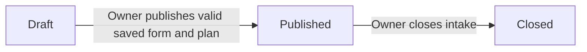
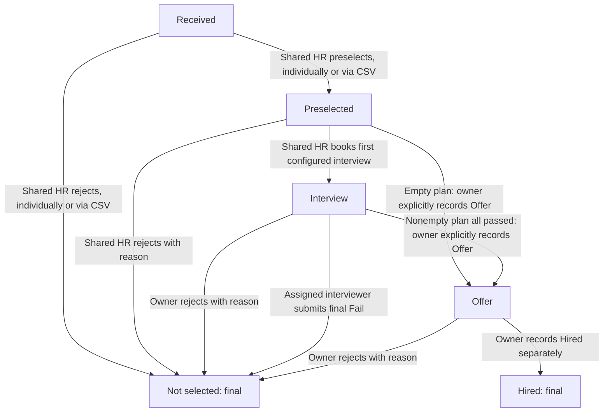
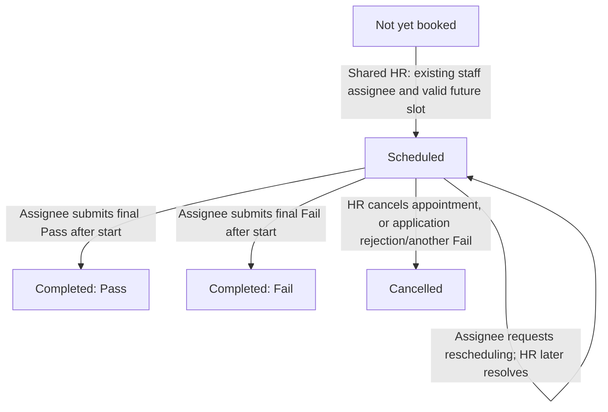

# Transition map for manual QA

Source-derived expectations, not executed passes. On 2026-11-08 the user reported inspecting different seeded states, **not exercising transitions**. Do not close Q-T2A or other gates from that report. Recruitment, processing, readiness and review are separate dimensions; do not interpret the diagrams as one mandatory linear workflow. AI remains fixture/disabled only.

## Vacancy lifecycle



Draft metadata/form/tasks and the optionally empty interview plan are editable only before publication. Publication freezes both. Only published vacancies accept new submissions; a candidate submits once per vacancy and a duplicate returns the existing submission. Closing intake does not cancel applications/interviews or prevent their later progression. No reopen, archive/fill semantics or candidate withdrawal/resubmission is implemented. Same-state publish/close is an idempotent API no-op, not a new lifecycle transition.

## Recruitment — every current state-changing edge



- Screening is allowed while extraction/review is pending, failed or unfinished. Either screening outcome permanently closes processing and freezes corrections while preserving unfinished review status. Export/preview alone changes nothing; CSV apply commits only the confirmed included set atomically. Excluded/missing rows remain unchanged. No screening undo, silent partial success or automatic retry.
- First booking moves Preselected to Interview. More bookings, rescheduling and Pass keep Interview; Pass does not automatically book the next interview or offer. A nonempty plan cannot use the empty-plan shortcut; missing/cancelled/failed interviews do not count as passed.
- Owner means the actual vacancy owner: other HR/admin cannot override Offer/Hired or rejection after interviews begin. An assigned HR staff member may give feedback only in their assignee capacity.
- Interview Fail or owner rejection cancels remaining scheduled instances. Hired/Not selected cannot reopen; Offer can still be rejected. There is no direct Received → Offer/Hired or Preselected → Hired edge.
- `review_ready` remains a compatible legacy recruitment value but no current command creates it; when encountered it has the same initial screening paths as Received. Candidate projections still mask the internal recruitment stage; use the HR view for these checks.

## Each configured interview appointment



Only the assignee can submit feedback/request rescheduling; feedback is denied before start. HR rescheduling requires a valid future non-overlapping slot and clears the scheduling request. Pass/Fail and cancellation are final: one instance per configured interview, no rebooking a cancelled instance or editing submitted feedback. Cancellation alone does not reject the application or move it back to Preselected; it leaves the nonempty plan incomplete. Prefer rescheduling when the interview should still happen. Reassignment removes the old assignee's candidate access unless another active/completed assignment still grants it.

## Extraction, readiness and human review — independent of recruitment

```text
With extraction tasks:
  Pending → Processing → Completed / Completed with errors
  Completed with errors → Processing only for eligible retryable unfinished work

Review readiness:
  Waiting → Ready when every task settles successfully or with ordinary terminal failure
  Waiting → Blocked for operational, uncertain or unclassified failure
  Blocked → Waiting/Ready only if eligible fixture processing resolves it
  Waiting or Blocked → Released after explicit shared-HR confirmation
  Ready or Released → Locked when HR completes review
  Any extraction-bearing readiness → Locked when screening commits

Human review (only Ready/Released, undecided, not already completed):
  Pending ↔ In review
  Pending or In review → Completed (final)

Without extraction tasks:
  Not requested + Review not applicable (no human reviewer/time)
```

- Original values/fixture provenance and HR overrides remain distinct. An empty successful skills list differs from failure/unavailable/null. Saving a real correction normally enters In review; saving unchanged content preserves status/editor/time. Reset to pending changes the review marker, not original evidence or screening.
- Ordinary terminal failure can permit review with missing values; operational/uncertain/unclassified or retry exhaustion does not. All frozen tasks must settle and the processing invocation must finish. With fixtures, the operator runs explicit commands; API startup does not process submissions.
- Release permanently closes processing, keeps original task/aggregate values and leaves human review unfinished; it does not fabricate extraction success or make a screening decision. Already-admitted external work is not proven cancelled; do not use live AI for this QA. Release denies naturally ready, no-task or locked work.
- Screening may freeze Pending/In review without marking it Completed. Review completion does not preselect, offer or hire. No-task applications may proceed through all recruitment paths without a review journey.
- Completed tasks are not rerun. Review completion/screening/release fence further processing writes. Retry/recovery conditions need separate technical checks; uncertain paid-attempt recovery is still a known safety gap, not an approved manual live test.

## Manual path coverage menu

Use a separate application for each terminal branch; later perform reset only in an agreed operation. These are targets, not instructions to execute all at once:

1. Received → screening rejection, including pending extraction.
2. Received → Preselected → later rejection (shared HR).
3. Empty plan: Received → Preselected → Offer → Hired (owner finalization).
4. Empty plan: Received → Preselected → Offer → owner rejection.
5. Configured plan: Preselected → first booking → optional reschedule/request/reassignment → all Pass → explicit Offer → Hired.
6. Configured plan: Interview → any final Fail → rejection and remaining cancellations.
7. Configured plan: Interview → owner rejection; separately test Offer → owner rejection.
8. Cancellation-only: remains Interview, cannot replace cancelled instance or offer with incomplete plan.
9. Natural success / ordinary failure → review edit/reset-to-pending/complete; screening remains a separate decision.
10. Pending / blocked → explicit release → review edit/complete; separately screen while review is unfinished and verify lock without fabricated completion.
11. No tasks → screening/finalization without review; closed intake → existing application still progresses.
12. Negative checks: non-owner finalization, unassigned/early feedback, frozen plan edits, terminal reopening, unchanged saves and conflicting edits.

There is no business-history/undo UI, but hidden **revision counters still enforce conflicts**. Another user's stale save must require refresh, not overwrite or silently merge. Refresh/reapply and dirty-navigation tests are separate Q-R3* gates. See [workflow rules](../workflows.md), [interview contract](../contracts/interview-api.md) and [review contract](../contracts/processing-review-api.md).
